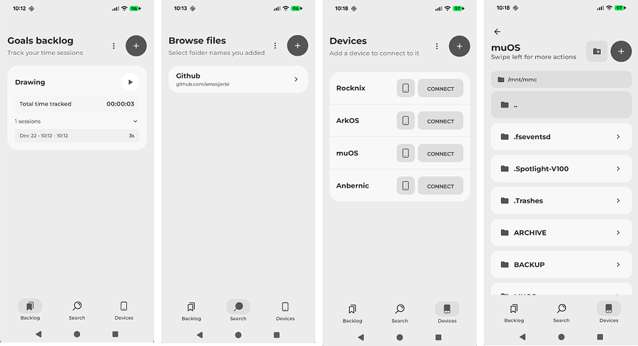
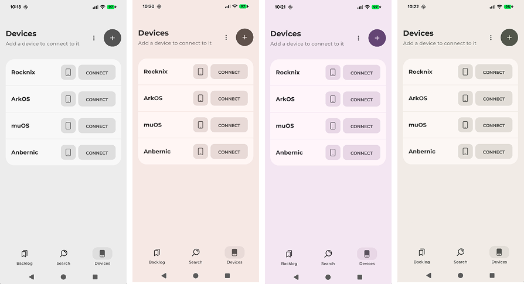

# Romnix - Retro Gaming File Manager

<div align="center">
  
  
  **A modern Android app for managing and transferring files to retro gaming devices**
  
  [](https://github.com/your-repo/romnix)
  [](https://android-arsenal.com/api?level=24)
  [](https://kotlinlang.org/)
</div>

## 📱 Overview

Romnix is a comprehensive Android application designed for retro gaming enthusiasts who want to easily manage, search, and transfer files to their handheld gaming devices like RockNix, Lakka, muOS, and other Linux-based retro gaming systems.

### 🎮 Main Features



- **File Search & Discovery**: Browse and search files across multiple platforms and sources
- **Device Management**: Connect to retro gaming devices via SSH/SFTP
- **File Transfer**: Seamlessly upload files to connected devices
- **Backlog Management**: Keep track of files you want to download or play
- **Remote File Browser**: Navigate and manage files on connected devices
- **Multi-Platform Support**: Works with various retro gaming platforms (NES, SNES, Genesis, Game Boy, etc.)

## 🎨 Design & Theming



Romnix features a modern Material 3 design with:
- **Dynamic Theming**: Adapts to your device's color scheme
- **Light & Dark Modes**: Seamless theme switching
- **Consistent UI**: Material You design principles throughout
- **Smooth Animations**: Polished user experience with fluid transitions

## 🏗️ Architecture

### Tech Stack
- **Language**: Kotlin
- **UI Framework**: Jetpack Compose
- **Architecture**: MVVM with ViewModels
- **Networking**: OkHttp for web requests, SSHJ for device connections
- **Storage**: DataStore for preferences, local file management
- **Minimum SDK**: Android 7.0 (API 24)
- **Target SDK**: Android 15 (API 35)

### Key Components

#### 📱 Screens
- **BacklogScreen**: Manage your file wishlist and downloads
- **BrowseScreen**: Search and browse files by platform
- **DevicesScreen**: Connect and manage retro gaming devices
- **FileBrowserScreen**: Remote file management on connected devices
- **SettingsScreen**: App configuration and preferences

#### 🌐 Networking
- **SshTester**: Test connections to retro gaming devices
- **SshUploader**: Transfer files to devices via SFTP
- **SshFileManager**: Browse and manage remote files
- **HostScanner**: Discover devices on local network

#### 🎮 Supported Devices
- **RockNix**: Linux-based handheld gaming OS
- **Lakka**: RetroArch-based gaming distribution
- **muOS**: Minimal Unix-like OS for retro handhelds
- **Custom SSH-enabled devices**: Any Linux device with SSH access

## 🚀 Getting Started

### Prerequisites
- Android device running Android 7.0 (API 24) or higher
- Retro gaming device with SSH access (optional)
- Network connection for file browsing

### Installation
1. Download the latest APK from the releases page
2. Enable "Install from unknown sources" in Android settings
3. Install the APK file
4. Launch Romnix and accept the disclaimer

### First Setup
1. **Accept Disclaimer**: Review and accept the terms on first launch
2. **Add Devices** (Optional): Configure your retro gaming devices
   - Go to Devices tab
   - Tap "+" to add a device
   - Enter device IP, username, and password
   - Test connection
3. **Browse Files**: Use the Search tab to find files
4. **Build Backlog**: Add interesting files to your backlog

## 📋 Features in Detail

### 🔍 File Search & Browse
- Search across multiple file sources
- Filter by gaming platform (NES, SNES, Genesis, etc.)
- Preview file details and metadata
- Add files to backlog for later download

### 📱 Device Management
- **Auto-Discovery**: Scan local network for compatible devices
- **Manual Configuration**: Add devices by IP address
- **Connection Testing**: Verify SSH connectivity
- **Multiple Device Support**: Manage multiple retro gaming devices
- **Template System**: Quick setup for common device types (RockNix, Lakka, muOS)

### 📂 File Management
- **Remote File Browser**: Navigate device file systems
- **Upload Files**: Transfer files directly to device folders
- **File Operations**: Rename, copy, delete files on remote devices
- **Download Files**: Pull files from devices to Android storage
- **Folder Management**: Create and organize directories

### 📝 Backlog System
- **File Wishlist**: Keep track of files you want to play
- **Download Queue**: Manage file downloads
- **Progress Tracking**: Monitor download status
- **Export/Import**: Backup your backlog data

### ⚙️ Settings & Configuration
- **Theme Selection**: Choose between light and dark modes
- **Download Settings**: Configure download behavior
- **Device Templates**: Manage device connection presets
- **Data Management**: Export/import app data

## 🔧 Technical Details

### Dependencies
```kotlin
// Core Android
implementation("androidx.core:core-ktx:1.13.1")
implementation("androidx.activity:activity-compose:1.9.0")

// Jetpack Compose
implementation("androidx.compose.ui:ui")
implementation("androidx.compose.material3:material3")
implementation("androidx.compose.foundation:foundation")

// Networking
implementation("com.squareup.okhttp3:okhttp:4.12.0")
implementation("com.hierynomus:sshj:0.37.0")

// Storage
implementation("androidx.datastore:datastore-preferences:1.0.0")
implementation("androidx.documentfile:documentfile:1.0.1")

// Cryptography
implementation("org.bouncycastle:bcprov-jdk15to18:1.77")
implementation("net.i2p.crypto:eddsa:0.3.0")
```

### Build Configuration
- **Compile SDK**: 35
- **Min SDK**: 24
- **Target SDK**: 35
- **Version Code**: 30
- **Version Name**: 1.0.20

### Permissions
```xml
<uses-permission android:name="android.permission.INTERNET" />
<uses-permission android:name="android.permission.WRITE_EXTERNAL_STORAGE" android:maxSdkVersion="28" />
<uses-permission android:name="android.permission.READ_EXTERNAL_STORAGE" android:maxSdkVersion="32" />
```

## 🤝 Contributing

We welcome contributions to Romnix! Here's how you can help:

1. **Fork the repository**
2. **Create a feature branch**: `git checkout -b feature/amazing-feature`
3. **Make your changes**: Follow Kotlin coding standards
4. **Test thoroughly**: Ensure your changes work across different devices
5. **Commit your changes**: `git commit -m 'Add amazing feature'`
6. **Push to branch**: `git push origin feature/amazing-feature`
7. **Open a Pull Request**

### Development Setup
1. Clone the repository
2. Open in Android Studio
3. Sync Gradle dependencies
4. Build and run on device/emulator

## 📄 License

This project is licensed under the MIT License - see the [LICENSE](LICENSE) file for details.

## 🙏 Acknowledgments

- **RetroArch Team**: For the amazing retro gaming ecosystem
- **RockNix/Lakka Communities**: For creating excellent handheld gaming OS distributions
- **Material Design Team**: For the beautiful design system
- **Jetpack Compose Team**: For the modern UI toolkit

## 📞 Support

- **Issues**: Report bugs and feature requests on GitHub Issues
- **Discussions**: Join community discussions on GitHub Discussions
- **Email**: Contact the development team at [your-email@example.com]

## 🔄 Changelog

### Version 1.0.20 (Latest)
- Enhanced Material 3 theming
- Improved SSH connection stability
- Better file transfer progress tracking
- UI/UX improvements across all screens
- Bug fixes and performance optimizations

---

<div align="center">
  <strong>Made with ❤️ for the retro gaming community</strong>
</div>